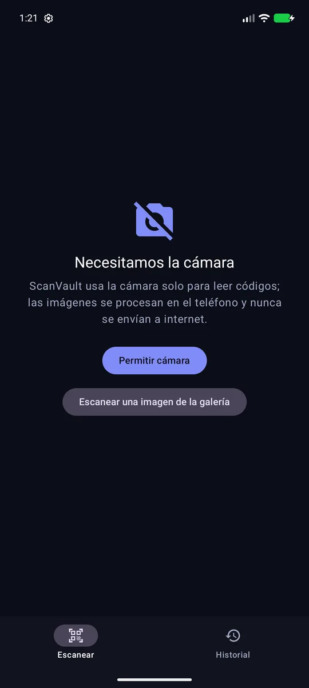
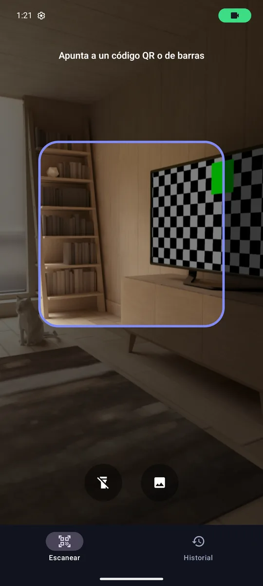
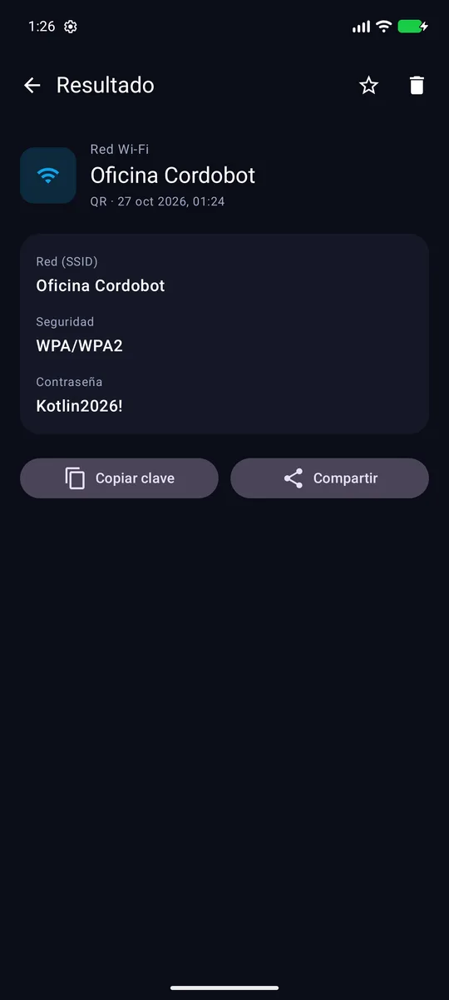
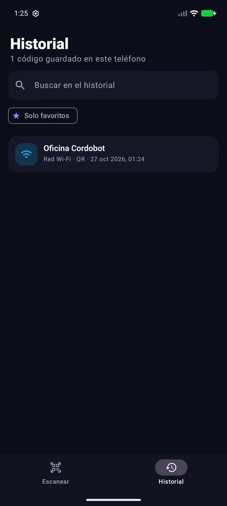

# ScanVault 🔍

Escáner de **códigos QR y de barras** para Android que usa la **cámara del teléfono** (CameraX) y
**reconocimiento en el dispositivo** con ML Kit: no envía imágenes a internet. Interpreta lo que lee
(enlaces, redes Wi-Fi, contactos, teléfonos, correos, ubicaciones, productos) y guarda un historial
local con favoritos.


| Permiso explicado | Cámara | Resultado (Wi-Fi) | Historial |
|:---:|:---:|:---:|:---:|
|  |  |  |  |

---

## Tabla de contenido

- [Qué problema resuelve](#qué-problema-resuelve)
- [Funcionalidades](#funcionalidades)
- [Stack tecnológico](#stack-tecnológico)
- [Arquitectura](#arquitectura)
- [Permisos, batería y memoria](#permisos-batería-y-memoria)
- [Pruebas](#pruebas)
- [Compilar y ejecutar](#compilar-y-ejecutar)

## Qué problema resuelve

Los QR están en menús, redes Wi-Fi, tarjetas de contacto y empaques, pero la cámara del sistema solo
muestra el texto en crudo. ScanVault lo convierte en acciones útiles (abrir, llamar, copiar la clave del
Wi-Fi…) y conserva lo escaneado para encontrarlo después, todo sin conexión.

## Funcionalidades

- 📷 **Escaneo en vivo** con CameraX y ML Kit (QR, Aztec, Data Matrix, PDF417, EAN-8/13, UPC, Code 39/93/128, ITF, Codabar).
- 🖼️ **Escanear desde la galería** con el Photo Picker del sistema (sin permiso de almacenamiento).
- 🔦 **Linterna** cuando el dispositivo tiene flash.
- 🧠 **Interpretación del contenido**: URL, Wi-Fi (SSID, seguridad, contraseña con escapes `\;`), vCard y MECARD,
  correo, teléfono, SMS, coordenadas `geo:`, códigos de producto y texto.
- ⚡ **Acciones**: abrir enlace, llamar, escribir correo, ver en el mapa, buscar producto, copiar (o copiar la clave
  del Wi-Fi) y compartir.
- 🗂️ **Historial** en Room con búsqueda, favoritos y borrado; una misma lectura repetida en 10 s se guarda una sola vez.

## Stack tecnológico

| Área | Tecnología |
|------|------------|
| Lenguaje | Kotlin 2.0, Coroutines, Flow |
| UI | Jetpack Compose, Material 3, Navigation Compose, `AndroidView` para `PreviewView` |
| Cámara | CameraX (`Preview` + `ImageAnalysis`, `bindToLifecycle`) |
| Visión | ML Kit Barcode Scanning (modelo en el dispositivo) |
| Arquitectura | Clean Architecture (data / domain / presentation) + MVVM |
| DI | Hilt |
| Persistencia | Room |
| Calidad | LeakCanary (solo *debug*), JUnit 4 |

## Arquitectura

```
presentation  ScannerScreen ─ BarcodeAnalyzer (CameraX + ML Kit) ─► ScannerViewModel
              ResultScreen / HistoryScreen (+ ViewModels)
                     │
domain        ContentParser (texto crudo → tipo, título, detalles, acción)   ← Kotlin puro
              SaveScanUseCase (evita duplicados) · FilterHistoryUseCase · ScanRepository
                     ▲
data          ScanRepositoryImpl → Room (ScanDao)
```

ML Kit solo entrega el texto y el formato; toda la interpretación vive en `ContentParser`, que no depende de
Android y está cubierto por pruebas unitarias.

## Permisos, batería y memoria

- **Permiso de cámara en tiempo de ejecución** con tres estados: concedido, pedir (con explicación de para qué se
  usa) y **denegado permanentemente** (botón a *Ajustes* de la app). Al volver de Ajustes se revisa de nuevo en
  `ON_RESUME`. Mientras tanto, se puede escanear desde la galería.
- **Batería**: la cámara se enlaza al ciclo de vida (`bindToLifecycle`), así que se detiene sola en segundo plano;
  el análisis usa 1280×720 en vez de resolución completa, `STRATEGY_KEEP_ONLY_LATEST` (descarta fotogramas en vez de
  encolarlos) y se **pausa tras cada detección**.
- **Memoria**: `DisposableEffect` libera la cámara y cierra el cliente de ML Kit al salir de la pantalla. LeakCanary
  está incluido en *debug* para detectar fugas de `Activity`/`View` durante el desarrollo.

## Pruebas

```bash
./gradlew :app:testDebugUnitTest
```

- `ContentParserTest`: Wi-Fi con caracteres escapados y redes abiertas, URLs con y sin esquema, vCard y MECARD,
  teléfono, SMS, correo, `geo:`, productos y texto.
- `UseCaseTest`: una lectura repetida en la ventana de 10 s no duplica el historial; búsqueda por título interpretado
  y favoritos.

## Compilar y ejecutar

Requisitos: Android Studio (Ladybug o superior), JDK 17, Android SDK 35. Sin claves ni servicios externos.

```bash
./gradlew :app:assembleDebug
adb install -r app/build/outputs/apk/debug/app-debug.apk
```

> En el emulador la cámara muestra una escena virtual; para probar, usa **Escanear desde la galería** con una imagen
> de un QR o un dispositivo físico.

---

Desarrollado por **Adrián Alvarez** ([@Cordobot](https://github.com/Cordobot)).

© 2026 Adrián Alvarez. Todos los derechos reservados.
